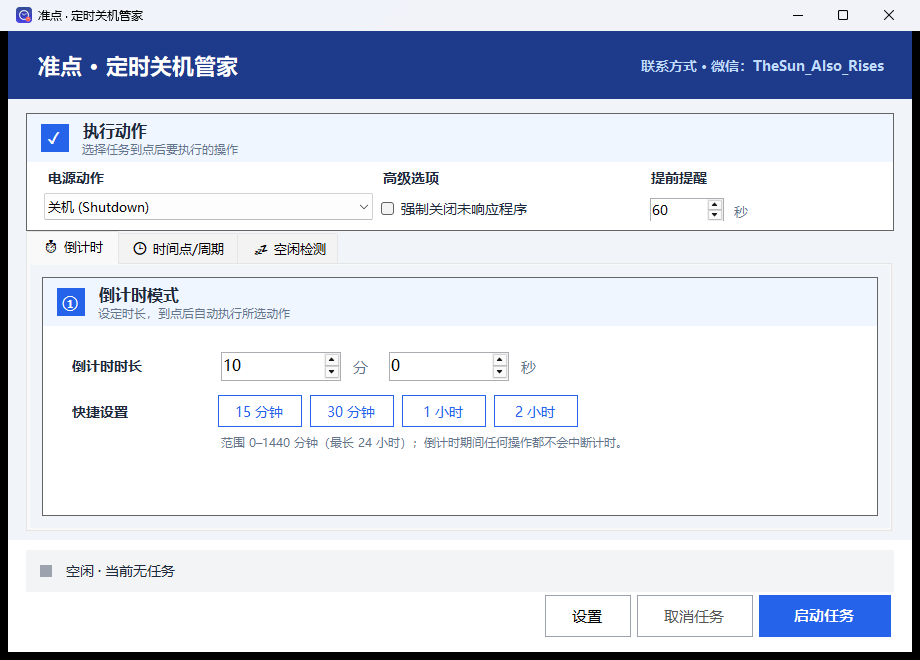

<div align="center">
  

# 准点 · 定时关机管家 · Windows 绿色单文件定时关机工具

**多种定时模式 + 七种电源动作，到点自动执行，提前提醒可取消可贪睡——双击即用，无需安装。**

v1.0 · Windows 10/11 x64 · 单文件绿色版 · Apache-2.0

</div>



> 全程本地运行，不联网、不上传任何数据。配置文件仅写入本机用户目录（`%AppData%\PowerOffManager`）。开机自启时只在右下角托盘运行，不弹出主界面。

| 想做什么 | 直接看这里 |
| --- | --- |
| 直接下载使用（不编译） | 本仓库 Releases 下载 `准点定时关机管家.exe` |
| 从源码运行 / 自己打包 | [5. 构建](#5-构建) |
| 看懂三种定时模式 | [1. 它能做什么](#1-它能做什么) |
| 了解界面与操作流程 | [2. 界面预览](#2-界面预览) · [4. 使用流程](#4-使用流程) |
| 目录结构与技术要点 | [6. 目录结构](#6-目录结构) · [7. 技术要点](#7-技术要点) |
| 授权与第三方组件 | [9. 许可与第三方组件](#9-许可与第三方组件) |

---

## 1. 它能做什么

一款面向 Windows 的定时关机工具：设定好任务后，程序到点自动执行关机、重启、睡眠等电源动作。它以**绿色单文件 EXE** 分发，双击即用，不写注册表、无需安装，可放 U 盘随身携带。

核心能力：

- **三种定时触发模式**
  - 倒计时：设定 N 分 N 秒后执行（0–1440 分钟，最长 24 小时），提供 15 分 / 30 分 / 1 小时 / 2 小时快捷按钮
  - 时间点 / 周期：指定时刻执行，支持一次性、每天、每周（可勾选星期）；一次性任务当天时刻已过则顺延次日
  - 空闲检测：无键鼠操作达到设定时长后执行（1–240 分钟），状态栏实时显示当前空闲秒数
- **七种电源动作**：关机 / 重启 / 睡眠 / 休眠 / 注销 / 锁屏 / 关闭显示器，可勾选"强制关闭未响应程序"
- **提前提醒与贪睡**：执行前 30–300 秒弹窗提醒，可选择立即执行、取消，或推迟 5 / 10 / 30 分钟
- **托盘常驻与开机自启**：关闭窗口默认最小化到托盘；开机自启时只在托盘运行、不弹主界面，双击托盘图标唤出
- **任务持久化**：配置与任务状态保存到 `config.json`，程序重启后自动恢复上次任务

## 2. 界面预览

主界面采用冷蓝配色的卡片式布局，顶部为联系方式，中部为电源动作与三种模式页签，底部为状态栏与操作按钮。


> 界面内嵌作者微信号，如图所示。托盘图标为蓝色磁贴 + 白色时钟 + 红色电源标记。

## 3. 快速开始

### 方式 A：直接运行打包版（推荐）

1. 到本仓库 Releases 下载 `准点定时关机管家.exe`
2. 双击运行，无需安装（首次运行若触发 SmartScreen，点"更多信息 → 仍要运行"）
3. 选择模式、设置动作与时长，点击"启动任务"

### 方式 B：从源码运行

```bash
# 需要 .NET 8 SDK（Windows），验证环境 SDK 8.0.428
# 克隆仓库后进入目录
cd 准点定时关机管家

# 直接运行（生成 WinForms 窗口）
dotnet run --project src/PowerOffManager.csproj -c Release
```

## 4. 使用流程

1. **选电源动作**：在顶部"执行动作"卡片选择关机 / 重启 / 睡眠等，按需勾选强制关闭、设置提前提醒秒数
2. **选定时模式**：在下方页签选择倒计时 / 时间点周期 / 空闲检测，填写对应参数
3. **启动任务**：点击右下角"启动任务"。若开启"关闭窗口时最小化到托盘"，窗口会自动隐藏到托盘
4. **等待提醒**：到点前弹窗提醒，可立即执行、取消或贪睡
5. **到点执行**：动作在后台线程执行，关机/重启优先调用系统 `shutdown.exe /s /f /t 0`，不阻塞界面
6. **随时管理**：托盘右键可查看状态、取消任务、暂停提醒 1 小时、打开设置或退出

## 5. 构建

```bash
# 在仓库根目录执行，产出 dist/PowerOffManager.exe（自包含单文件，约 68 MB）
dotnet publish src/PowerOffManager.csproj -c Release -r win-x64 \
  --self-contained true \
  -p:PublishSingleFile=true \
  -p:IncludeNativeLibrariesForSelfExtract=true \
  -p:EnableCompressionInSingleFile=true \
  -p:DebugType=None \
  -o dist
```

> 图标通过 `assets/make_icon.py`（Python + Pillow）程序化生成，已提供成品 `app-icon.ico`，一般无需重新生成。重新生成命令：`python assets/make_icon.py`。

## 6. 目录结构

```
准点定时关机管家/
├── src/                        # C# 源码
│   ├── Program.cs              # 程序入口、启动模式判断（--autostart）、图标加载、日志
│   ├── MainForm.cs             # 主界面、托盘菜单、设置对话框、线程封送
│   ├── Scheduler.cs            # 调度引擎：三种模式计时、提醒、贪睡、幂等执行
│   ├── NativeMethods.cs        # Win32 API：电源动作、空闲检测、提权、shutdown 兜底
│   ├── ConfigService.cs        # 配置持久化、开机自启快捷方式、旧配置兼容
│   ├── ReminderForm.cs         # 关机前提醒弹窗（含贪睡）
│   └── PowerOffManager.csproj  # 项目文件（net8.0-windows / WinForms / 单文件发布）
├── assets/                     # 图标与生成脚本
│   ├── app-icon.ico            # 多尺寸图标（16/24/32/48/64/128/256），嵌入 EXE
│   ├── app-icon-256.png
│   ├── app-icon-1024.png
│   └── make_icon.py            # Pillow 程序化图标生成脚本
├── screenshots/
│   └── 主界面.png              # 界面预览
├── docs/                       # 历史设计与需求文档（旧版四模式描述，仅供参考，以源码为准）
│   ├── PRD-定时关机管家.md
│   └── P-01-主界面-wireframe.html
├── LICENSE                     # Apache License 2.0
├── NOTICE.md                   # 第三方组件声明
├── CONTRIBUTING.md             # 贡献指南
└── README.md
```

## 7. 技术要点

- **.NET 8 WinForms 单文件**：`PublishSingleFile` + `SelfContained` + 运行时压缩，产出单个绿色 EXE；图标作为嵌入资源打包进 PE 资源段（`RT_ICON` / `RT_GROUP_ICON`）
- **执行可靠性**：提权时检查 `GetLastError` 并关闭 token 句柄；关机/重启优先走系统 `shutdown.exe /s /f /t 0` 强制兜底；`Interlocked` 幂等闸门防止重复触发
- **不假死**：关机动作放后台线程执行，不阻塞 UI；定时器事件通过 `InvokeRequired + BeginInvoke` 正确封送回 UI 线程
- **空闲检测**：用 `GetLastInputInfo` 读取无输入时长；为贪睡维护独立时间戳，避免贪睡后立即重复提醒
- **启动模式区分**：开机自启快捷方式带 `--autostart` 参数，程序据此只创建托盘、不显示主界面；程序启动时会自动修复旧版无参数快捷方式
- **DPI 适配**：`PerMonitorV2` 高清模式；界面用 `TableLayoutPanel` 网格 + 卡片式分区自适应布局

## 8. 常见问题

**Q：首次运行被 SmartScreen 拦截 / 杀软报毒？**
A：单文件 EXE 未签名，可能触发提示，点"更多信息 → 仍要运行"即可；若杀软误报，将该 EXE 加入白名单。这是未签名程序的普遍现象，非恶意行为。

**Q：设置了开机自启，但开机后没看到界面？**
A：这是设计行为——自启时程序只在右下角托盘运行。双击托盘图标即可唤出主界面；托盘图标可能被 Windows 折叠，点任务栏 `^` 展开。

**Q：时间到了但电脑没关机？**
A：请确认动作是否选了"关机"而非"锁屏 / 关显示器"，以及是否有程序阻止关机（可勾选"强制关闭未响应程序"）。查看 `%AppData%\PowerOffManager\logs` 下的日志可定位执行记录。

**Q：配置文件在哪里？如何彻底退出？**
A：配置在 `%AppData%\PowerOffManager\config.json`。彻底退出请右键托盘图标选"退出"——直接关窗口只是最小化到托盘。

## 9. 许可与第三方组件

本项目以 **Apache License 2.0** 授权，许可全文见 [LICENSE](LICENSE)。

第三方组件及其许可见 [NOTICE.md](NOTICE.md)。本项目运行时不依赖第三方库；发布产物自包含 Microsoft .NET 8 运行时。

## 免责声明

本工具会实际执行关机、重启、注销等系统电源操作。使用前请保存好工作；弹窗提醒后到点将自动执行，请确认动作类型与时长设置正确。作者不对因使用本工具造成的数据丢失或业务中断承担责任。

---

作者：TheSun_Also_Rises　|　联系方式：微信 TheSun_Also_Rises
