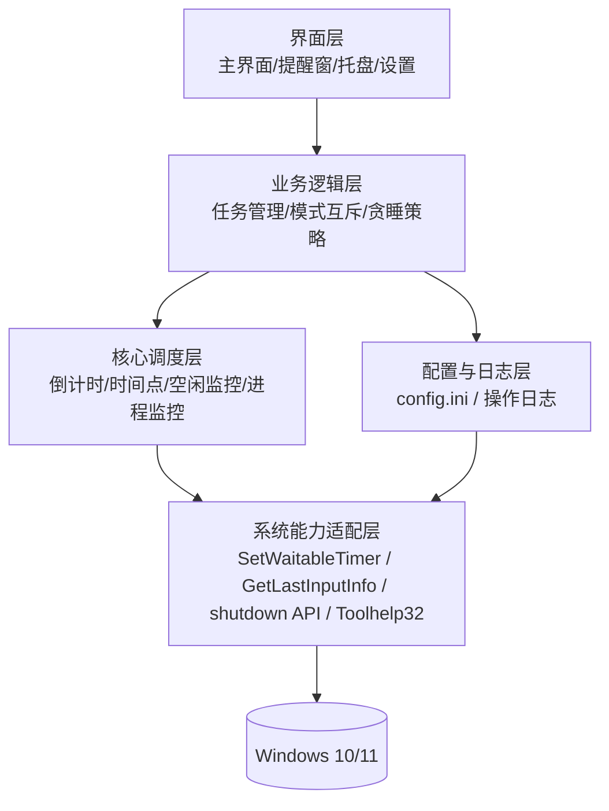
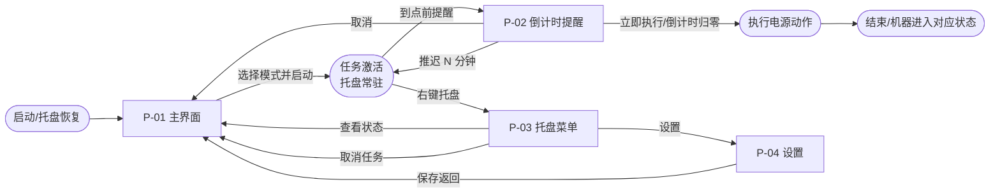

# 准点 · 定时关机管家（PowerOff Manager）需求文档（PRD）

| 项目 | 内容 |
| --- | --- |
| 版本 | v1.0 |
| 日期 | 2026-11-22 |
| 状态 | 已锁定（Round 2 复评完成） |
| 需求提出人 | 市场部 / 个人单机用户 |
| 文档负责人 | 产品经理（AI 辅助） |
| 目标平台 | Windows 10 1809+ / Windows 11（x64），绿色单文件 EXE |
| 适用读者 | 开发、测试、需求提出人 |

> **一句话结论**：做一款**双击即用、无需安装的绿色单文件 EXE** 定时关机工具，统一支持「倒计时 / 指定时间点与周期 / 空闲检测 / 进程触发」四种定时模式，以及「关机 / 重启 / 睡眠 / 休眠 / 注销 / 锁屏 / 关显示器」七种电源动作，配可取消的倒计时提醒与贪睡；推荐用 **C#/.NET WinForms 单文件发布**实现，在本机（Windows 11 x64，已装 .NET SDK）即可直接构建调试。

---

## 0. 假设与待确认项（必读）

| 编号 | 假设 / 待确认 | 来源 | 影响范围 | 确认状态 |
| --- | --- | --- | --- | --- |
| Q-01 | 开发机 = 执行环境 = 目标平台，均为家里这台 Windows 11 x64 | 用户 Round 1 明确回答 | 方案比选、构建方式 | ✅ 已确认 |
| Q-02 | 交付形态 = 绿色单文件 EXE（双击即用、不写注册表、可放 U 盘） | 用户 Round 1 明确回答 | 打包方式、配置存储位置 | ✅ 已确认 |
| Q-03 | 定时模式全选四种；关机形式全选三种（电源动作 / 进程触发 / 提醒贪睡） | 用户 Round 1 明确回答 | 功能范围、里程碑 | ✅ 已确认 |
| Q-04 | 目标最低系统版本暂定 Windows 10 1809+ | 缺省假设 | 唤醒定时器 API、兼容范围 | ⚠️ 待确认（建议确认实际使用机器最低版本） |
| Q-05 | 接受未提供代码签名证书，首版附白名单与 SmartScreen 处理指引 | 缺省假设 | 分发体验、误报处理 | ⚠️ 待确认（若有证书可显著提升体验） |
| Q-06 | 进程触发默认按「进程名」匹配，进阶支持窗口标题匹配 | 缺省假设 | 进程监控模块设计 | ⚠️ 待确认 |
| Q-07 | 开机自启通过「启动文件夹快捷方式」实现，不改注册表（保持绿色） | 缺省假设 | 自启功能实现 | ⚠️ 待确认 |
| Q-08 | 用户场景为本人单机使用，无多用户/远程集中管理需求 | 缺省假设 | 权限模型、架构复杂度 | ⚠️ 待确认 |

> 本章需在开发启动会上逐条过一遍；Q-04 / Q-05 会直接影响 R-02 / R-03 的缓解成本。

---

## 1. 背景与目标

> **一句话结论**：解决「手动关机要盯着时间、临时有事忘记关、下载/渲染完想自动关」这三类痛点，用一个常驻托盘的小工具把关机变成可预期、可取消、可追溯的动作。

| 项目 | 内容 |
| --- | --- |
| 要解决的问题 | ① 下班前手动关机常忘记或要等到点；② 下载/渲染/挂机任务完成后无人关机；③ 人离开但电脑空转，浪费电与寿命；④ 现有 `shutdown -s -t` 命令行不直观、无法管理多个场景。 |
| 现状与为什么现在做 | 系统自带「任务计划程序」配置繁琐、无托盘状态、无法一键取消；命令行缺乏提醒与贪睡。本机已具备 .NET SDK，具备低成本自研条件。 |
| 成功标准 | 四种模式均能准点触发（误差 ≤ 5 秒，睡眠场景 ≤ 60 秒）；关机前必有 ≥ 30 秒可取消提醒；连续运行 30 天无内存泄漏；干净机器双击可运行、误报有明确处置指引。 |
| 不在本期范围 | 远程/集中管理、手机端控制、自动更新、多语言、云同步、自定义皮肤主题（Won't）。 |

---

## 2. 用户与场景

| 用户角色 | 使用场景 | 触发时机 | 期望结果 | 频率 |
| --- | --- | --- | --- | --- |
| 本人（单机办公） | 下班前设倒计时关机 | 17:55 设 10 分钟后关机 | 到点弹提醒，可推迟，最终自动关机 | 每工作日 |
| 本人（挂机任务） | 下载/渲染完成后关机 | 启动大文件下载时设「进程触发」 | 下载进程退出后自动关机 | 每周 2-3 次 |
| 本人（影音/阅读） | 睡前定时 | 设「指定时间点」23:30 睡眠 | 到点进入睡眠，按键可唤醒 | 每天 |
| 本人（离席） | 人走电脑空转 | 设「空闲 15 分钟关机」 | 无键鼠操作满 15 分钟提醒后关机 | 不定时 |
| 家人（共用机） | 不想被误关 | 我设置了任务但家人正在用 | 提醒弹窗可被任何人取消，日志记录 | 偶发 |

---

## 3. 功能清单与优先级（MoSCoW）

> **一句话结论**：Must 级共 11 项，覆盖「设任务 → 到点提醒 → 执行动作 → 可追溯」完整闭环；Should 级 5 项提升专业度，Won't 级明确锁死范围防止蔓延。

| ID | 功能 | 描述 | 优先级 | 所属页面 | 验收要点 |
| --- | --- | --- | --- | --- | --- |
| F-01 | 倒计时定时 | 设置 N 分/小时后执行动作，实时显示剩余时间 | Must | P-01 | 倒计时误差 ≤ 5 秒，暂停/取消可用 |
| F-02 | 指定时间点 | 设当天某时刻（如 23:30）执行 | Must | P-01 | 到点准时触发，跨日自动失效 |
| F-03 | 周期任务 | 按每天 / 每周指定星期重复执行 | Must | P-01 | 勾选周一至周日，下次触发日计算正确 |
| F-04 | 空闲检测 | 无键鼠操作达到阈值（1-240 分钟）后触发 | Must | P-01 | 模拟无操作到点触发，有操作自动重置计时 |
| F-05 | 进程触发 | 监控指定进程，进程退出后触发（可设延迟 0-60 分钟） | Must | P-01 | 目标进程结束后按延迟触发；同名进程不误触 |
| F-06 | 电源动作 | 关机 / 重启 / 睡眠 / 休眠 / 注销 / 锁屏 / 关显示器（7 选 1） | Must | P-01 | 每种动作在测试机验证生效，休眠需系统支持 |
| F-07 | 倒计时提醒 | 执行前弹出提醒窗（默认 60 秒，可设 30-300 秒） | Must | P-02 | 到点前必弹，显示动作类型与剩余秒数 |
| F-08 | 贪睡/取消 | 提醒窗支持「立即执行 / 取消 / 推迟 5/10/30 分钟」 | Must | P-02 | 取消后任务终止；推迟后按新时间再次提醒 |
| F-09 | 单任务激活 | 任意时刻仅 1 个任务处于激活态，新模式替换旧模式并提示 | Must | P-01 | 切换模式时旧任务自动停用，界面状态同步 |
| F-10 | 托盘常驻 | 最小化到托盘、右键菜单（查看状态/取消任务/退出） | Must | P-03 | 托盘图标显示倒计时悬浮提示，右键菜单可用 |
| F-11 | 配置持久化 | 任务配置与偏好保存到本地文件，重启程序后恢复 | Must | P-04 | 退出重开后激活任务与设置保持 |
| F-12 | 开机自启 | 可选通过启动文件夹快捷方式实现 | Should | P-04 | 勾选后登录自动启动，取消后移除快捷方式 |
| F-13 | 操作日志 | 记录任务设置/触发/取消/执行结果与时间，可导出 txt | Should | P-04 | 每次操作落日志，可按日期查看与清空 |
| F-14 | 强制选项 | 「强制关闭未响应程序」开关（对应 `shutdown -f`） | Should | P-01 | 开启后执行时不等待程序响应 |
| F-15 | 系统事件联动 | 检测锁屏/RDP 会话，给出「当前会话可能被影响」提示 | Should | P-02 | RDP 会话下触发前有额外确认 |
| F-16 | 多显示器/DPI 适配 | 高 DPI 下界面清晰 | Should | 全部 | 150%/200% 缩放测试通过 |
| F-17 | 多语言界面 | 中英文切换 | Could | P-04 | 后续版本 |
| F-18 | 自定义提醒音 | 用户替换提醒音效 | Could | P-04 | 后续版本 |
| W-01 | 远程/集中管理 | 局域网批量下发关机任务 | Won't | — | 本期明确不做 |
| W-02 | 自动更新 / 云同步 | 在线升级、配置云备份 | Won't | — | 本期明确不做 |

---

## 4. 非功能需求

| 类别 | 要求 | 验收方式 |
| --- | --- | --- |
| 性能 | 冷启动 ≤ 2 秒；常驻内存 ≤ 80 MB；空闲检测轮询 CPU 占用 < 1% | 任务管理器采样 + 30 分钟监控 |
| 兼容性 | Windows 10 1809+ / Windows 11 x64；兼容 32 位系统则额外出 x86 包（暂定仅 x64） | 虚拟机矩阵安装测试（Q-04 待确认） |
| 数据安全 | 配置存 `%APPDATA%\PowerOffManager\config.ini`（绿色版可切同目录）；不采集任何个人信息；不联网 | 抓包确认无出站连接 + 目录检查 |
| 可靠性 | 睡眠/休眠后可唤醒并准点触发；倒计时用单调时钟，避免系统时间被改导致错乱；异常退出不影响已设置任务 | 睡眠 30 分钟测试 + 改系统时间测试 + 强杀进程测试 |
| 可维护性 | 结构化日志 + 一键打包诊断信息；错误码 + 原因 + 建议文案 | 人为制造失败场景，文案评审 |
| 许可 | 仅使用 MIT / Apache-2.0 依赖，禁止 GPL/AGPL 传染性组件 | 依赖清单扫描 |

---

## 5. 落地思路总览（一图看懂）


**文字拆解**

| 阶段 | 关键动作 | 产出 | 依赖 |
| --- | --- | --- | --- |
| 1 环境准备 | 确认 .NET SDK 版本、确定最低系统版本、评估签名 | 可构建环境 | Q-04 / Q-05 拍板 |
| 2 核心能力 | 调度引擎 + 唤醒定时器 + 电源动作 + 进程/空闲监控 | 可运行 MVP | 阶段 1 |
| 3 交互与线稿落地 | 主界面、提醒弹窗、托盘、设置，按线稿实现 | 可演示版本 | 阶段 2 |
| 4 加固与分发 | 边界测试、误报处理、日志、单文件打包 | 可交付 EXE | 阶段 3 |

### 模块分层图



> 关键设计：**TimerService 单一实例**统一持有激活任务，所有模式都向它注册，从根本上避免 R-04（多模式冲突）。

---

## 6. 环境适配结论

> **一句话结论**：开发机、执行环境、目标平台三者合一（均为本机 Windows 11 x64），**无交叉编译成本，为原生适配**；唯一外部成本来自代码签名与杀软误报。

| 目标平台 | 开发可行性 | 运行可行性 | 分发可行性 | 等级 | 依据与附加条件 |
| --- | --- | --- | --- | --- | --- |
| Windows 11 x64（本机） | 可（dotnet SDK 已装） | 可 | 可（未签名有 SmartScreen 提示） | **原生适配** | 探测确认 build 26100 / AMD64 |
| Windows 10 1809+ x64 | 可 | 可（需能力检测） | 同上 | **原生适配** | 唤醒定时器 API 在 Win8+ 可用；Q-04 待确认 |
| Windows 7 / x86 | 可但需降版本 | 有条件 | 同上 | **需替代方案** | .NET 8 不支持 Win7；如需支持改用 .NET Framework 4.8 或 Python 方案，另立需求 |

**探测依据**（本机 shell 原始输出摘要）：

```text
OS:   MINGW64_NT-10.0-26100 x86_64     → Windows 11, build 26100
ARCH: AMD64                             → x64
FOUND dotnet      → /c/Program Files/dotnet/dotnet
FOUND python      → Python 3.13.12（含 PyInstaller）
MISS  go/gcc/clang/iscc                 → 无 Go/C 编译器/Inno Setup
```

**交叉开发说明**：无。用户 Round 1 确认开发机即家里这台 Windows，省去 Mac→Windows 的 CI/虚拟机/签名跨平台成本（对比技能参考矩阵第 5 节）。

**工具链清单**：.NET 8 SDK（已装）+ WinForms + `dotnet publish -r win-x64 --self-contained true -p:PublishSingleFile=true`（单文件原生支持）；备选 Python 3.13 + PyInstaller（已装，但误报率与启动速度劣势明显）。

---

## 7. 风险登记册

> **一句话结论**：共登记 12 项风险，其中 6 项高影响；所有高风险均有明确缓解方案与验收方式，结论为「可落地」。标 ⭐ 的 4 项为用户原始描述中**未提及的隐藏风险**。

| 编号 | 类别 | 风险描述 | 触发条件 | 影响 | 缓解方案 | 验收方式 | 责任阶段 |
| --- | --- | --- | --- | --- | --- | --- | --- |
| R-01 | 需求与逻辑 | 关机不可逆，误设/忘记取消导致工作丢失 | 用户设完任务后继续工作，到点被强制关机 | **高** | 执行前 ≥ 30 秒可取消提醒；默认动作前二次确认；完整操作日志；支持全局一键取消 | 强制关机前必有可取消窗口；取消后不执行 | M2 |
| R-02 ⭐ | 平台与权限 | 系统睡眠/休眠打断后台定时，到点不触发 | 设置了夜间定时任务，机器进入睡眠 | **高** | 使用 `SetWaitableTimer` + `CREATE_WAITABLE_TIMER_HIGH_RESOLUTION`/唤醒标志，或注册任务计划程序唤醒；睡醒后校核补触发 | 睡眠 30 分钟后准点触发（误差 ≤ 60 秒） | M2 |
| R-03 ⭐ | 工程与分发 | 单 EXE 被 Defender / 第三方杀软误报、删除 | PyInstaller 打包尤其高发；即使 .NET 单文件亦有概率 | **高** | 首选 .NET 降低混淆度；提供白名单添加指引；发布前多引擎扫描；条件允许则代码签名 | 干净机器可运行；VirusTotal 检出率记录存档 | M4 |
| R-04 | 需求与逻辑 | 多模式同时激活互相冲突 | 用户先设倒计时，又设空闲关机 | 中 | TimerService 单实例 + 模式互斥，新任务替换旧任务并弹提示 | 任意时刻仅 1 个激活任务 | M2 |
| R-05 ⭐ | 需求与逻辑 | 进程触发误判 | 同名进程（如多个 chrome.exe）、系统关键进程退出 | **高** | 支持进程名 + 窗口标题双重匹配；排除系统关键进程白名单；触发前显示「检测到进程 X 已退出」确认 | 同名/系统进程测试用例通过 | M3 |
| R-06 | 平台与权限 | 权限不足导致关机失败 | 标准用户账户、组策略禁止关机 | 中 | 启动时检测权限与策略，给出明确文案与建议；必要时请求 UAC 提升 | 标准用户账户下行为符合预期 | M3 |
| R-07 ⭐ | 数据与兼容 | 系统时间被修改导致倒计时错乱 | 用户手动改时间、NTP 校时、跨时区 | **高** | 倒计时用 `Stopwatch`/单调时钟；时间点模式用绝对时间记录并在触发前校核；提醒文案显示本地时间 | 修改系统时间后倒计时仍准确 | M2 |
| R-08 | 数据与兼容 | 退出后配置/任务丢失 | 程序崩溃或正常退出重开 | 中 | 配置写 ini/json，关键状态每次变更即落盘；提供了写入失败的降级提示 | 强杀进程后重启，任务可恢复 | M3 |
| R-09 | 交互与可维护性 | 错误文案不可行动 | 只显示「执行失败」 | 中 | 统一错误码 + 原因 + 下一步建议（如「请检查是否被安全软件拦截」） | 文案评审通过 | M3 |
| R-10 | 工程与许可 | 第三方组件传染性许可 | 若选 Python + PySide6（GPL/LGPL） | **高** | 推荐 .NET（MIT）；Python 方案限定 tkinter 标准库；依赖清单审查 | 依赖清单无 GPL/AGPL | M1 |
| R-11 | 交付与分发 | 未签名触发 SmartScreen「未知发布者」 | 用户从网络下载首次打开 | 中 | 签名证书预算评估；未签名时提供「更多信息→仍要运行」图文指引 | 干净机器可完成首次启动 | M4 |
| R-12 ⭐ | 平台与权限 | 远程桌面会话中误关影响他人 | 通过 RDP 登录办公机设任务 | 中 | 检测会话类型（`WTSGetActiveConsoleSessionId` / `GetSystemMetrics(SM_REMOTESESSION)`），触发前额外确认 | RDP 会话下有额外确认提示 | M3 |

---

## 8. 方案比选

> **一句话结论**：**推荐方案 B（.NET WinForms 单文件），加权 4.00 分**；方案 A（Python + PyInstaller）3.80 分居次；方案 C（Tauri/Electron）2.35 分不建议。结论在权重浮动下稳健，但对「开发成本」维度敏感（见敏感性检查）。

### 8.1 候选方案

| 方案 | 技术栈 | 形态 | 核心取舍 |
| --- | --- | --- | --- |
| **A · Python + PyInstaller** | Python 3.13 + tkinter + ctypes 调 Win32 API | onefile 单 EXE（50-80 MB） | 开发最快、本机现成；启动慢（2-5 秒解压）、内存大、误报高发 |
| **B · .NET WinForms 单文件**（推荐） | C# / .NET 8 + PublishSingleFile | 单 EXE（自包含约 60-70 MB / 依赖框架约 200 KB） | 系统 API 原生支持、启动快、误报较低、MIT 许可；C# 开发略繁琐 |
| **C · Tauri / Electron** | Web 前端 + Rust/Chromium | 单 EXE | 界面现代但体积/内存开销大，系统级关机需额外桥接，杀鸡用牛刀 |

### 8.2 加权评分矩阵

| 维度 | 权重 | A · Python | B · .NET | C · Tauri/Electron | 评分依据 |
| --- | --- | --- | --- | --- | --- |
| 开发成本 | 30% | **4** | 3 | 2 | A 语法简洁、本机现成；B 系统 API 原生但代码量稍多；C 需前端+Rust/Node 双栈 |
| 运行性能与体验 | 25% | 2 | **5** | 2 | B 启动快常驻小、原生托盘；A onefile 每次解压启动慢；C 内存占用最大 |
| 与现有环境匹配度 | 15% | **5** | 4 | 2 | 本机 Python+PyInstaller 与 dotnet 均装；C 缺 Node/Rust 工具链 |
| 可维护性 | 15% | 4 | **4** | 3 | A/B 均为单代码库易维护；C 依赖框架升级频繁 |
| 上架与分发难度 | 10% | 3 | **4** | 3 | B 单文件发布原生支持且误报较低；A 误报高；三者均面临未签名问题 |
| 合规与许可风险 | 5% | 4（tkinter）/ 2（PySide6） | **5** | 4 | .NET MIT；Python 标准库无风险但 GUI 库需谨慎；Tauri Apache/MIT |
| **加权总分** | 100% | **3.80** | **4.00** | **2.35** | 按 A(tkinter) 计分 |

### 8.3 敏感性检查（最高权重项 ±20%）

| 场景 | A · Python | B · .NET | 结论是否翻转 |
| --- | --- | --- | --- |
| 基准（开发成本 30%） | 3.80 | **4.00** | B 胜 0.20 |
| 开发成本上浮至 36%（其余等比缩减） | 3.82 | **3.92** | 不翻转，但差距缩至 0.10 |
| 开发成本下调至 24%（体验更重要） | 3.78 | **4.08** | 不翻转，B 优势扩大 |

> **结论对「开发成本」维度敏感但稳健**。决策条件：若要求「一周内必须出可用版本」且能接受启动慢与较高误报 → 选 A；若追求「比较专业」的品质与长期维护 → 选 B。用户原话强调「专业」，故推荐 B。

### 8.4 推荐结论与否决理由

```
推荐：方案 B · .NET WinForms 单文件（加权 4.00）
理由：
  1) 系统级能力（关机/空闲检测/唤醒定时器/进程快照）有原生 API，可靠性优于 ctypes 拼装；
  2) 单文件发布为 .NET 官方能力，启动快、误报率低，契合「专业 + 绿色单 EXE」诉求；
  3) MIT 许可零传染风险，符合用户一贯的 Apache/MIT 选型偏好。
MVP 范围：仅 Must 级 F-01 ~ F-11（四种模式 + 七种电源动作 + 提醒贪睡 + 托盘 + 持久化）。
否决理由：
  - 方案 A：PyInstaller onefile 启动 2-5 秒、内存 100MB+、Defender 误报高发，与「专业」定位冲突；
            若强依赖 PySide6 还引入 GPL/LGPL 风险（R-10）。仅在「一周内必须交付」时作为降级备选。
  - 方案 C：为系统级关机引入 Chromium/Rust 桥接，体积与复杂度失控，无任何收益（R-03/R-06 风险放大）。
```

### 8.5 许可审查

| 依赖 | 许可 | 风险 | 结论 |
| --- | --- | --- | --- |
| .NET 8 / WinForms | MIT | 无 | ✅ 可商用 |
| Windows SDK / P/Invoke（系统自带） | 微软系统 API | 无额外分发 | ✅ 可用 |
| 日志库（如需，如 Serilog） | Apache-2.0 | 无 | ✅ 可商用 |
| 禁止项 | GPL / AGPL / SSPL 组件 | 传染性 | ❌ 不引入 |

---

## 9. 实施里程碑


| 里程碑 | 起止（建议） | 交付物 | 验收标准 | 依赖 |
| --- | --- | --- | --- | --- |
| M1 环境就绪 | 11-23 ~ 11-24 | 可构建环境 + 版本结论 | 干净机器可 `dotnet publish` 出单 EXE | Q-04/Q-05 拍板 |
| M2 核心可用 | 11-25 ~ 12-03 | 调度引擎 + 三种触发 + 七种动作 | 四种模式触发测试通过；睡眠唤醒通过（R-02/R-07） | M1 |
| M3 可演示 | 12-04 ~ 12-11 | 主界面/提醒窗/托盘/设置 + 日志 | 线稿页面全部实现；R-05/R-06/R-12 缓解项通过 | M2 |
| M4 可交付 | 12-12 ~ 12-18 | 绿色单文件 EXE + 白名单指引 | 全量验收通过；干净机双击运行；许可清单合规 | M3 |

---

## 10. 原型线稿

> **一句话结论**：共 6 个页面，其中 4 个 Must 级页面已出低保真灰阶线稿，单文件 HTML 离线可打开；标注编号与说明表一一对应。

**页面清单**

| 编号 | 页面 | 平台 | 对应功能 | 优先级 |
| --- | --- | --- | --- | --- |
| P-01 | 主界面 / 任务配置 | 桌面工具窗 900×620 | F-01 ~ F-06, F-09, F-14 | Must |
| P-02 | 倒计时提醒弹窗 | 弹窗 460×280 | F-07, F-08, F-15 | Must |
| P-03 | 系统托盘菜单 | 托盘右键 | F-10 | Must |
| P-04 | 设置 / 偏好 | 桌面工具窗 720×520 | F-11 ~ F-13, F-16 | Must |
| P-05 | 运行中悬浮状态 | 桌面浮层 240×90 | F-01 状态展示 | Should |
| P-06 | 首次运行引导 | 弹窗 520×360 | 白名单与权限提示 | Could |

**页面流转**



**线稿文件**

| 页面 | 文件路径 | 说明 |
| --- | --- | --- |
| P-01 ~ P-04（合订） | `wireframes/P-01-主界面-wireframe.html` | 单文件 HTML，含 4 个画板 + 顶部页面流转图 + 底部标注表 |
| 流转图 | 内嵌于上述 HTML 顶部（内联 SVG，离线可用） | 标注跳转条件与返回路径 |

**标注说明**

| 编号 | 页面 | 组件 | 交互规则 | 业务规则 | 边界状态 |
| --- | --- | --- | --- | --- | --- |
| ① | P-01 | 模式选择页签 | 点击切换 4 种模式 | 切换时若已有激活任务，弹确认后替换（F-09/R-04） | 有激活任务时页签旁显示提示点 |
| ② | P-01 | 参数配置区 | 按模式显示不同表单 | 倒计时：分钟数 1-1440；时间点：HH:mm；空闲：1-240 分；进程：进程名+延迟 | 超范围输入标红并禁用启动按钮 |
| ③ | P-01 | 动作下拉框 | 选择 7 种电源动作之一 | 休眠在不支持的机器上置灰并提示（F-06/R-06） | 权限不足时显示提示文案 |
| ④ | P-01 | 启动/取消按钮 | 启动激活任务；取消终止 | 单任务互斥；启动后按钮变「取消任务」 | 无有效参数时启动禁用 |
| ⑤ | P-01 | 状态条 | 显示当前激活任务摘要与剩余时间 | 空闲/进程模式显示「监测中」而非倒计时 | 无任务时显示「当前无任务」空态 |
| ⑥ | P-02 | 提醒弹窗主体 | 到点自动弹出，置顶 | 显示动作类型、剩余秒数、当前时间；默认 60 秒可设 30-300（F-07） | RDP 会话时追加额外确认（F-15/R-12） |
| ⑦ | P-02 | 推迟按钮组 | 点击推迟 5/10/30 分钟 | 重新进入激活态并再次提醒（F-08） | 连续推迟上限 10 次，防无限拖延 |
| ⑧ | P-03 | 托盘右键菜单 | 右键图标展开 | 查看状态 / 取消任务 / 设置 / 退出 | 无任务时「取消任务」置灰 |
| ⑨ | P-04 | 自启与日志开关 | 勾选生效 | 自启写入启动文件夹快捷方式（Q-07）；日志存本地可导出（F-13） | 无写权限时提示降级路径 |

---

## 11. 验收标准

| 编号 | 验收项 | 判定条件 | 关联需求 / 风险 |
| --- | --- | --- | --- |
| AC-01 | 四种模式触发 | 倒计时/时间点/周期/空闲/进程按设定准确触发，误差 ≤ 5 秒（睡眠 ≤ 60 秒） | F-01~F-05, R-02 |
| AC-02 | 七种电源动作 | 每种动作在测试机验证生效（含不支持环境的降级提示） | F-06, R-06 |
| AC-03 | 可取消与贪睡 | 提醒窗可取消/推迟，取消后不执行；日志有记录 | F-07/F-08, R-01 |
| AC-04 | 中断恢复 | 强制结束进程、系统睡眠、修改系统时间后仍能正确触发 | R-02/R-07/R-08 |
| AC-05 | 单任务互斥 | 任意时刻仅 1 个激活任务，切换模式有提示 | F-09, R-04 |
| AC-06 | 干净机运行 | 未装开发环境的 Windows 11 机器双击 EXE 可运行；误报有处置指引 | R-03/R-11 |
| AC-07 | 许可合规 | 依赖清单无 GPL/AGPL/SSPL | R-10 |
| AC-08 | DPI 与托盘 | 150%/200% 缩放下界面清晰；托盘菜单与悬浮提示正常 | F-10/F-16 |
| AC-09 | 配置持久化 | 退出重开后任务与设置保持；强杀后不丢配置 | F-11, R-08 |
| AC-10 | 空态与边界 | 无任务、超范围输入、目标进程不存在等边界均有明确反馈 | R-09 |

---

## 12. 复评记录

| 轮次 | 日期 | 主要结论 | 用户反馈 | 因反馈改变的条目 |
| --- | --- | --- | --- | --- |
| Round 1 | 2026-11-22 | 初判倾向 Python + PyInstaller（因本机现成）；识别 6 类风险；列出 4 个待拍板点 | 绿色单 EXE；四种模式全选；三种关机形式全选；开发机为家里 Windows | — |
| Round 2 | 2026-11-22 | 三者合一 → 交叉成本归零，适配升为原生；范围扩为 Must 11 项；方案重算后 B 反超 A | 用户确认按推荐执行 | ① 推荐方案由 A 改为 B（开发成本敏感但专业诉求占优）；② 范围由基础定时扩展为四模式+三形式；③ 新增 R-05/R-07/R-12 三条隐藏风险；④ 交付形态锁定 onefile，配置存储改为同目录/APPDATA 持久化 |

> **定稿标记**：结论已锁定，可进入开发排期。开发启动会上需先关闭 Q-04 / Q-05 两个待确认项。

---

## 附录

- **A. 探测命令与原始输出**：见第 6 章代码块（本机 shell 实测）。
- **B. 依赖与许可清单**：见 8.5 节。
- **C. 术语表**：MoSCoW（Must/Should/Could/Won't 优先级模型）；onefile（单文件打包）；P/Invoke（.NET 调用 Windows 原生 API）；贪睡（Snooze，推迟执行）。
- **D. 参考来源与查证方式**：
  - Windows `shutdown` 命令与电源管理 API：Microsoft Learn（搜索 "Shutdown" / "SetWaitableTimer" / "GetLastInputInfo"）。
  - .NET 单文件发布：`dotnet publish -p:PublishSingleFile=true` 官方文档（Microsoft Learn 搜索 "Single-file deployment"）。
  - 许可：MIT / Apache-2.0 官方许可证文本。
  - ⚠️ 最低系统版本与签名策略为假设项，查证方式：确认实际部署机器版本、咨询是否已有代码签名证书。
